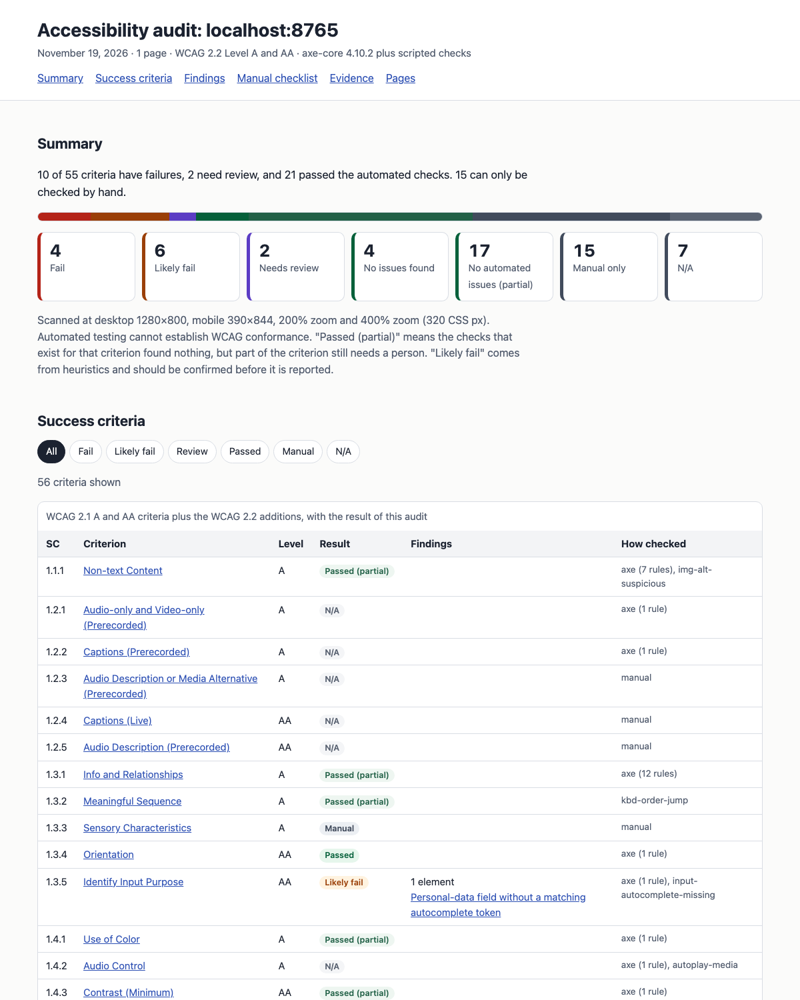

# claude-wcag-audit

A [Claude Code](https://claude.com/claude-code) plugin, also usable in Grok Build, that audits a website against WCAG 2.1 and 2.2 Level A and AA. Ask Claude to audit a site and you get an HTML report with a result for every success criterion, the failing elements with fixes, and a checklist of what still needs a person.



## Why

Most automated accessibility checks run axe-core and stop there. axe is excellent at what it covers, but it only has rules for about 22 of the 50 WCAG 2.1 A/AA success criteria, and many of those only partially. It doesn't press Tab, zoom the page, open a menu or apply text spacing, so keyboard traps, invisible focus, clipped text at 200% zoom and menus that only open on click all pass silently.

The plugin runs axe and then drives the page with Playwright the way a keyboard or low-vision user would. It's also explicit about coverage. Every criterion in the report is marked as failed, needing review, passed with good or partial coverage, manual only, or not applicable. That way a clean scan can't be mistaken for conformance.

## Install

This repository is a Claude Code plugin and its own marketplace. Grok Build reads the same plugin format, so it installs from here too.

It runs on macOS and Linux. Windows should work too, but hasn't been tested yet. You need Node.js 18 or later and npm. The first audit installs the pinned axe-core and Playwright, which takes about a minute. The audit also needs Chromium. If Playwright's browser isn't installed, the script falls back to any Chromium already in the Playwright cache or to `CHROME_BIN`, and otherwise prints the command that installs it.

### Claude Code

In Claude Code:

```
/plugin marketplace add LooporaData/claude-wcag-audit
/plugin install claude-wcag-audit@looporadata
```

From a terminal, the same thing is:

```bash
claude plugin marketplace add LooporaData/claude-wcag-audit
claude plugin install claude-wcag-audit@looporadata
```

To offer it to everyone working in a project, commit this to the project's `.claude/settings.json`. Claude Code then prompts each person to install it when they trust the folder.

```json
{
  "extraKnownMarketplaces": {
    "looporadata": { "source": { "source": "github", "repo": "LooporaData/claude-wcag-audit" } }
  },
  "enabledPlugins": { "claude-wcag-audit@looporadata": true }
}
```

To update, run `/plugin marketplace update looporadata`. To remove it, run `/plugin uninstall claude-wcag-audit@looporadata`. Dependencies go in the plugin's data folder.

### Grok Build

From a terminal:

```bash
grok plugin install LooporaData/claude-wcag-audit --trust
```

`--trust` lets the plugin's skill load without a separate confirmation. Without it, approve the plugin in `/plugins` before the skill shows up. Grok also picks up the `looporadata` marketplace if you've already added it in Claude Code, but install from the repository as above.

To update, run `grok plugin update`. To remove it, run `grok plugin uninstall claude-wcag-audit`. Dependencies go in `~/.cache/claude-wcag-audit`.

## Use

Ask for an audit:

```
/claude-wcag-audit:wcag-audit https://example.com
```

or just say "run an accessibility audit on our staging site". In Grok, ask it to use the wcag-audit skill. Claude finds the pages from the sitemap, runs the audit, checks the heuristic findings against the live page, and reports back with the report path.

## What it checks

Each page is loaded at four sizes: desktop (1280×800), mobile (390×844), 200% zoom and 400% zoom.

| Area | What the script does | WCAG |
|---|---|---|
| axe-core | Runs axe 4.10.2 with the WCAG 2.0, 2.1 and 2.2 A/AA tags plus best practices, at desktop and mobile. Undecided results (text on gradients, for example) are kept as "needs review". | many |
| Keyboard | Tabs through the whole page. At each stop it compares screenshots with and without focus, checks the element is visible and not hidden under a sticky header or banner, and watches for focus that moves the page or opens a window. Afterwards it reports traps, interactive elements Tab never reached, backwards jumps in focus order and broken skip links. | 2.1.1, 2.1.2, 2.4.1, 2.4.3, 2.4.7, 2.4.11, 3.2.1 |
| Menus and dialogs | Opens each menu, disclosure and dialog trigger with Enter and Space and compares that with a click. Checks `aria-expanded`, reruns axe on the opened state, and checks focus moves into dialogs, Escape closes them and focus returns. | 2.1.1, 2.4.3, 4.1.2 |
| Hover content | Hover-revealed submenus and tooltips must also appear on keyboard focus and close with Escape. | 1.4.13, 2.1.1 |
| Zoom and spacing | Looks for horizontal scrolling and clipped text at 320 CSS px, clipped text at 200%, and clipping after applying the WCAG text-spacing values. | 1.4.4, 1.4.10, 1.4.12 |
| Forms | Field border contrast of 3:1, autocomplete tokens on name, email, phone and similar fields, placeholder-only labels, and `<select>` changes that navigate. | 1.3.5, 1.4.11, 3.2.2, 3.3.2 |
| Motion | Infinite or long animations and autoplaying media, and whether `prefers-reduced-motion` stops them. | 1.4.2, 2.2.2 |
| Content | Generic and ambiguous link text, alt text that looks like a filename. | 1.1.1, 2.4.4 |
| Across pages | Duplicate titles, navigation order and the placement of contact or help links. | 2.4.2, 3.2.3, 3.2.6 |

The full mapping, including the manual steps left for each criterion, is in [`scripts/wcag.mjs`](scripts/wcag.mjs).

## The report

Each audit writes four things to the output folder:

- `report.html` is a single file with no external requests. It has the summary, a filterable table of all criteria linked to the W3C Understanding pages, findings grouped across pages, a manual checklist that remembers your ticks, an inventory for manual checks (images and alt text, forms, media, headings) and a per-page table. It works in light and dark mode, prints cleanly, and passes its own audit.
- `report.md` has the same content for pasting into issues or docs.
- `results.json` holds every raw finding.
- `shots/` holds the screenshots shown in the report. Every failing and likely-failing element gets a picture with the element outlined in red, and each review group gets four examples, taken in the state the check found it: under text spacing for clipped text, at 320px with the viewport edge marked for reflow. Missing focus indicators show the element while focused.

Findings are graded so you know how much to trust them:

| Grade | Meaning |
|---|---|
| Fail | A definite failure, such as an axe violation or a toggle that ignores the keyboard. |
| Likely fail | Found by a heuristic. Confirm it on the page before filing it. |
| Needs review | The tool can't decide. A person needs to look or make a call. |
| Best practice | Worth fixing, but not a WCAG A/AA failure. |

### Recording what you verified

Claude checks the likely fails and review items before reporting them, and you can do the same. Write the conclusions to `notes.json` in the output folder, keyed by the check id shown in the report:

```json
{
  "input-boundary-contrast": {
    "verdict": "confirmed",
    "note": "Border #919ab0 on white measured at 2.82:1."
  },
  "motion-no-pause": {
    "verdict": "decision",
    "note": "Hero animation stops under reduced motion. Product to decide on a pause control."
  }
}
```

Claude re-renders the reports after writing notes. To do it yourself from a clone, without scanning again:

```bash
node scripts/render.mjs a11y-report
```

`confirmed` turns a likely fail or review item into a fail. `false-positive` and `no-issue` move it to a "Resolved during verification" section and out of the criteria results. `decision` keeps it under review and labels it for the owner. A note without a verdict is shown as-is.

## Running the script directly

From a clone of this repository, after `npm install`:

```bash
node scripts/audit.mjs https://example.com --out a11y-report
node scripts/audit.mjs http://localhost:3000 --pages /,/contact,/pricing --out a11y-report
```

| Option | Default | |
|---|---|---|
| `--sitemap URL` | `<base>/sitemap.xml` | Sitemap indexes are followed. With no sitemap, links on the home page are crawled. |
| `--pages /a,/b` | | Paths or full URLs, instead of the sitemap |
| `--max-pages N` | 40 | |
| `--concurrency N` | 3 | Pages audited in parallel |
| `--max-tabs N` | 200 | Tab presses per page |
| `--skip LIST` | | Any of `keyboard`, `toggles`, `hover`, `mobile`, `zoom`, `spacing`, `shots` |
| `--max-shots N` | no limit | Overall limit on evidence screenshots |
| `--out DIR` | `./a11y-report` | |

Expect 20 to 40 seconds per page. The script never submits forms. It does open menus and dialogs and change `<select>` values, so run it against sites you own, ideally staging. It starts each page in a fresh browser with no login, so authenticated areas aren't covered yet.

## How it works

- axe is injected with Playwright's `page.evaluate` in a context that bypasses CSP, so a strict `script-src` doesn't block it. The script doesn't load anything from a CDN.
- The focus check takes a screenshot of each focused element and its surroundings, blurs it, takes another and counts pixels that changed significantly. Fewer than ten means there's no visible indicator.
- Zoom levels are real viewports at a higher device pixel ratio (640×400 at 2x for 200%, 320×256 at 4x for 400%), which matches how browser zoom changes layout.
- Clipping is found by measuring each text node's rendered boxes against the `overflow: hidden` ancestor that cuts it off. The finding names the element that holds the text and the box that clips it. Visually hidden text, `aria-hidden` content and text inside scrollable containers are ignored. A select chevron (a small no-repeat background image) does not skip the field-border check.
- The keyboard walk understands roving tabindex in tabs and menus, native date inputs and embedded frames, so those don't show up as traps or unreachable elements.

## Limits

Automated checks can't establish WCAG conformance. The report's manual checklist covers the rest. In particular, a person still needs to:

- test with a screen reader, including status messages and live regions;
- check captions, audio description and flashing content;
- test form error handling on a test environment;
- judge whether alt text, link text, headings and labels are meaningful;
- check pointer gestures, dragging and single-key shortcuts.

## Development

```
.claude-plugin/       plugin and marketplace manifests
skills/wcag-audit/SKILL.md  instructions Claude follows
scripts/audit.mjs     page discovery, browser checks, findings
scripts/deps.mjs      finds or installs axe-core and Playwright
scripts/page-helpers.js  in-page functions injected into every audited page
scripts/wcag.mjs      success criteria, coverage, check definitions
scripts/report.mjs    shared report model and Markdown output
scripts/html-report.mjs  HTML output
scripts/render.mjs    re-renders reports from results.json and notes.json
scripts/measure.mjs   re-measures contrast, target size and clipped text for notes.json
test/fixture.html     page with planted failures
```

To try local changes in Claude Code, start it with `claude --plugin-dir /path/to/claude-wcag-audit`. Bump `version` in `.claude-plugin/plugin.json` and `package.json` for each release, since installed copies update by version.

After changing a heuristic, audit the fixture and confirm every planted failure is still reported:

```bash
(cd test && python3 -m http.server 8765) &
node scripts/audit.mjs http://localhost:8765 --pages /fixture.html --out /tmp/fixture-report
```

Also run it against a real site you know well. Most heuristic bugs show up as false positives on production markup, not on the fixture.

## License

MIT, see [LICENSE](LICENSE).

axe-core (Deque Systems, [MPL-2.0](https://www.mozilla.org/MPL/2.0/)) and Playwright (Microsoft, Apache-2.0) are installed from npm at first run and aren't included in this repository. Versions are pinned in `package-lock.json`.

The idea of running axe from a Claude Code skill comes from [airowe/claude-a11y-skill](https://github.com/airowe/claude-a11y-skill).
